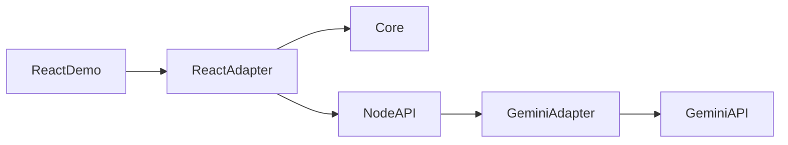

# AI-ассистент

Переносимый модуль диалогового ассистента на React и Node.js. Бизнес-логика диалога не зависит от React, браузера и Gemini: интерфейс и провайдер подключаются отдельно.



## Состав

- `packages/core` — сообщения, история, поток событий, отмена и хранилище.
- `packages/react` — хук `useAssistant`, HTTP-транспорт и хранение в `localStorage`.
- `packages/gemini` — серверный вызов Gemini через официальный `@google/genai`.
- `apps/demo` — самостоятельный чат, который использует эти пакеты.

Ключ Gemini остаётся только в серверном окружении. Браузер обращается к локальному `POST /api/chat` и получает ответ потоком NDJSON из событий `delta`, `done` и `error`.

## Требования

- Node.js 22 или новее.
- Аккаунт Google и API-ключ из [Google AI Studio](https://aistudio.google.com/apikey).

На бесплатном тарифе Google может использовать содержимое запросов для улучшения своих продуктов. Не отправляйте через него конфиденциальные данные. Модель по умолчанию — `gemini-3.5-flash`; её можно заменить переменной `GEMINI_MODEL`.

## Запуск демонстрации

```bash
npm install
cp .env.example .env
```

Запишите ключ в `.env`:

```env
GEMINI_API_KEY=ваш_ключ
GEMINI_MODEL=gemini-3.5-flash
```

Затем запустите клиент и сервер:

```bash
npm run dev
```

Интерфейс откроется на `http://localhost:5173`, API — на `http://localhost:8787`.

## Использование ядра отдельно

На сервере или в скрипте Node.js можно обойтись без React:

```js
import { createAssistant } from '@ai-assistant-kit/core'
import { createGeminiTransport } from '@ai-assistant-kit/gemini'

const assistant = createAssistant({
  transport: createGeminiTransport(),
  systemPrompt: 'Отвечай кратко и по делу.',
})

for await (const event of assistant.sendMessage('Привет')) {
  if (event.type === 'delta') process.stdout.write(event.text)
}
```

Любой другой провайдер достаточно реализовать как объект с методом `send({ messages, systemPrompt, signal })`. Он должен возвращать асинхронный поток событий `{ type: 'delta', text }`, `{ type: 'done', text }` или `{ type: 'error', message, code }`.

## Подключение к другому React-проекту

Установите пакеты из этого репозитория как workspace-зависимости либо скопируйте каталоги `packages/core` и `packages/react`. В приложении нужны React 18+ и доступный серверный маршрут `/api/chat`.

```jsx
import { createHttpTransport, createLocalStorage, useAssistant } from '@ai-assistant-kit/react'

const transport = createHttpTransport({ url: '/api/chat' })
const storage = createLocalStorage({ key: 'my-app.assistant' })

export function AssistantPanel() {
  const { messages, status, error, sendMessage, cancel, clear } = useAssistant({
    transport,
    storage,
    systemPrompt: 'Ты — помощник внутри приложения.',
  })

  // Транспорт и хранилище считываются при первом отображении компонента.
}
```

Серверную часть можно скопировать из `apps/demo/server` либо вызвать `createGeminiTransport()` в собственном API. Не импортируйте `@ai-assistant-kit/gemini` в браузерный код.

## Проверка

```bash
npm run lint
npm test
npm run build
```
